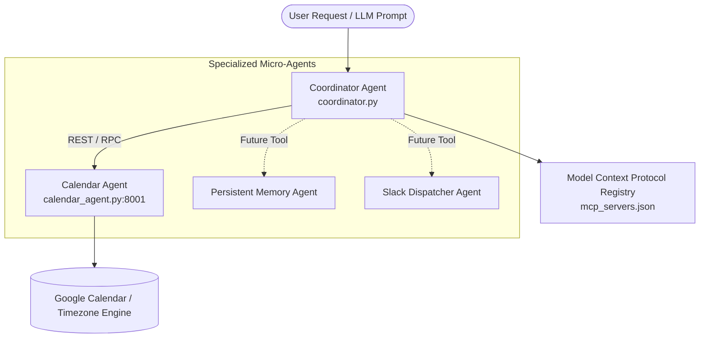

# Multi-Agent MCP Starter (Python + FastAPI)

[](https://www.python.org/downloads/)
[](https://fastapi.tiangolo.com)
[](https://modelcontextprotocol.io/)
[](LICENSE)

Production-ready architecture for building distributed, resilient multi-agent systems in Python using the **Model Context Protocol (MCP)** and **FastAPI microservices**.

Featured in the **Nexos AI Lab** deep dive:  
📺 **[Build a Multi-Agent System in Python with MCP (Calendar + Memory + Slack)](https://www.youtube.com/@NexosAILab)**

---

## 🎯 Architecture Overview

Monolithic agent frameworks often suffer from single points of failure, context saturation, and unhandled side-effects (such as timezone drift in calendar APIs). This repository decouples orchestration from execution through specialized micro-agents:



### Key Components

- **`coordinator.py`**: Orchestrates multi-step workflows, aggregates tool outputs, handles retry loops, and prevents cascade failures using async timeouts.
- **`calendar_agent.py`**: A specialized FastAPI service demonstrating strict timezone normalization via Python's native `zoneinfo`, resolving common UTC-drift bugs.
- **`mcp_servers.json`**: Official Model Context Protocol configuration registering tools, arguments, and endpoints for MCP-compliant hosts (Claude Desktop, Antigravity, Custom Clients).

---

## 🚀 Quickstart

### 1. Clone & Set Up Environment

```bash
git clone https://github.com/NexosAILab/multi-agent-mcp-starter.git
cd multi-agent-mcp-starter

python -m venv .venv
source .venv/bin/activate  # On Windows: .venv\Scripts\activate
pip install -r requirements.txt
```

### 2. Start the Calendar Micro-Agent

```bash
uvicorn calendar_agent:app --host 127.0.0.1 --port 8001 --reload
```

Interactive OpenAPI docs will be available at: `http://127.0.0.1:8001/docs`

### 3. Run the Coordinator Agent

In a separate terminal:

```bash
python coordinator.py
```

---

## 🛠️ MCP Integration

To register these micro-agents with Claude Desktop or an MCP host, add the servers listed in `mcp_servers.json` to your configuration file:

```json
{
  "mcpServers": {
    "calendar_agent": {
      "command": "python",
      "args": ["calendar_agent.py"],
      "env": {
        "PORT": "8001"
      }
    }
  }
}
```

---

## 🤝 Contributing

Contributions, issues, and feature requests are welcome! Feel free to check the [issues page](https://github.com/NexosAILab/multi-agent-mcp-starter/issues).

## 📄 License

This project is licensed under the MIT License - see the [LICENSE](LICENSE) file for details.
