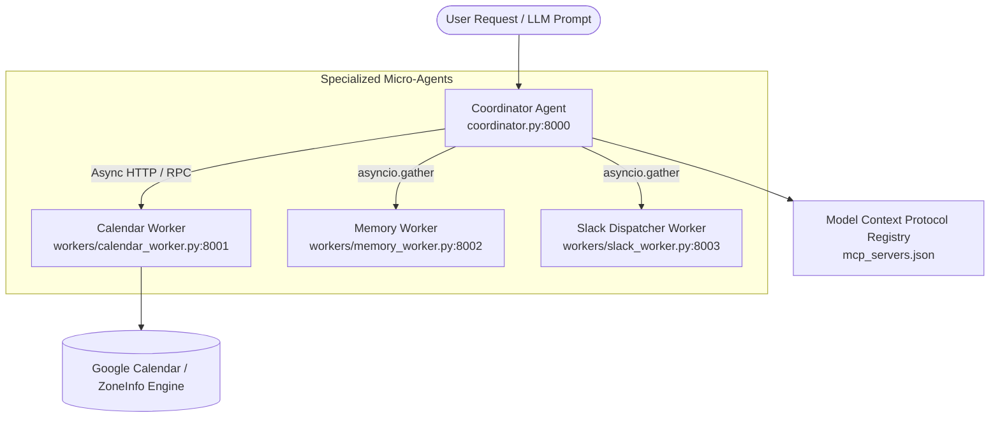

# Multi-Agent MCP Starter (Python + FastAPI)

[](https://www.python.org/downloads/)
[](https://fastapi.tiangolo.com)
[](https://modelcontextprotocol.io/)
[](LICENSE)
[](tests/)

Production-ready architecture for building distributed, resilient multi-agent systems in Python using the **Model Context Protocol (MCP)** and **FastAPI microservices**.

Featured in the **Nexos AI Lab** deep dive:  
📺 **[Build a Multi-Agent System in Python with MCP (Calendar + Memory + Slack)](https://www.youtube.com/watch?v=Q4apC-tffJc)**

---

## 🎯 Architecture Overview

Monolithic agent frameworks often suffer from single points of failure, context saturation, and unhandled side-effects (such as timezone drift in calendar APIs). This repository decouples orchestration from execution through specialized micro-agents:



### Key Components

- **`coordinator.py`**: Orchestrates multi-step workflows, aggregates tool outputs via `asyncio.gather`, handles retry loops, and prevents cascade failures using async timeouts.
- **`workers/calendar_worker.py`**: A specialized FastAPI service demonstrating strict timezone normalization via Python's native `zoneinfo`, resolving common UTC-drift bugs.
- **`workers/memory_worker.py`**: Session context and episodic memory store for multi-turn execution.
- **`workers/slack_worker.py`**: Outbound notification and event dispatching service.
- **`mcp_servers.json`**: Official Model Context Protocol configuration registering tools, arguments, and endpoints for MCP-compliant hosts (Claude Desktop, Antigravity, Custom Clients).

---

## 🚀 Quickstart

### 1. Clone & Set Up Environment

```bash
git clone https://github.com/NexosAILab/multi-agent-mcp-starter.git
cd multi-agent-mcp-starter

python -m venv .venv
source .venv/bin/activate  # On Windows: .venv\Scripts\activate
pip install -r requirements.txt
```

### 2. Start the Micro-Agent Workers

In separate terminals (or using a process runner):

```bash
# Terminal 1: Calendar Worker
uvicorn workers.calendar_worker:app --port 8001 --reload

# Terminal 2: Memory Worker
uvicorn workers.memory_worker:app --port 8002 --reload

# Terminal 3: Slack Worker
uvicorn workers.slack_worker:app --port 8003 --reload
```

### 3. Run the Coordinator Agent

```bash
python coordinator.py
```

Or trigger an end-to-end multi-agent workflow:
```bash
curl -X POST http://127.0.0.1:8000/execute_workflow \
  -H "Content-Type: application/json" \
  -d '{"event_title": "Executive AI Review", "start_time": "2026-11-15T15:00:00", "timezone_str": "America/New_York"}'
```

---

## 🧪 Testing

Run the automated test suite verifying deterministic timezone normalization and configuration manifests:

```bash
pytest tests/
# or
python tests/test_pipeline.py
```

---

## 🛠️ MCP Integration

To register these micro-agents with Claude Desktop or an MCP host, add the servers listed in `mcp_servers.json` to your configuration file:

```json
{
  "mcpServers": {
    "calendar_worker": {
      "command": "python",
      "args": ["workers/calendar_worker.py"],
      "env": { "PORT": "8001" }
    },
    "memory_worker": {
      "command": "python",
      "args": ["workers/memory_worker.py"],
      "env": { "PORT": "8002" }
    },
    "slack_worker": {
      "command": "python",
      "args": ["workers/slack_worker.py"],
      "env": { "PORT": "8003" }
    }
  }
}
```

---

## 🤝 Contributing

Contributions, issues, and feature requests are welcome! Feel free to check the [issues page](https://github.com/NexosAILab/multi-agent-mcp-starter/issues).

## 📄 License

This project is licensed under the MIT License - see the [LICENSE](LICENSE) file for details.
